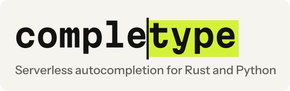

<p align="center">
  <picture>
    <source media="(prefers-color-scheme: dark)" srcset="https://raw.githubusercontent.com/sayef/completype/main/assets/banner-dark.svg">
    
  </picture>
</p>

<p align="center">
  <b>Autocompletion as a library. The database is a bucket.</b><br>
  Exact, prefix, infix, abbreviation, spelling-tolerant, word-decomposing and semantic completions,<br>
  ranked by popularity, inside your own process. No servers to run.
</p>

<p align="center">
  <a href="https://completype.pages.dev/">Docs</a> ·
  <a href="https://completype.pages.dev/getting-started/">Getting started</a> ·
  <a href="https://completype.pages.dev/reference/python/">Python API</a> ·
  <a href="https://docs.rs/completype">Rust API</a> ·
  <a href="https://completype.pages.dev/benchmarks/">Benchmarks</a> ·
  <a href="https://github.com/sayef/completype/blob/main/CHANGELOG.md">Changelog</a>
</p>

<p align="center">
  <a href="https://github.com/sayef/completype/actions/workflows/ci.yml"></a>
  <a href="https://crates.io/crates/completype"></a>
  <a href="https://docs.rs/completype"></a>
  <a href="https://pypi.org/project/completype/"></a>
  
  <a href="https://github.com/sayef/completype/blob/main/LICENSE"></a>
</p>

<p align="center">
  
</p>

completype is an autocompletion engine that your application embeds, in Rust or through first-class Python
bindings. In the spirit of [LanceDB](https://github.com/lancedb/lancedb), it is a library and not a service:
an object-store bucket or a local directory is the database, every process that serves completions reads
the index straight from storage, and writers coordinate through the storage itself. There is no cluster to
deploy, scale, upgrade or keep alive.

You give it documents (an id, a text, a popularity weight, and optionally aliases, tags and an embedding).
It completes what your users type with every kind of match an autocomplete box needs, ranked together, and
stays fresh while your data changes.

## What it completes

Real results from the index behind the demo above (23 short titles with popularity weights):

| Query | Top completion | Kind |
|---|---|---|
| `danc` | Dancing Queen – ABBA, Dancing in the Dark – Bruce Springsteen, Dancing On My Own – Robyn | `prefix`, by popularity |
| `rhcp` | Under the Bridge – Red Hot Chili Peppers | `abbreviation`, case-insensitive |
| `bohemain rapsody` | Bohemian Rhapsody – Queen | `fuzzy`: two misspelt words |
| `dancingqueen` | Dancing Queen – ABBA | `prefix`, after word decomposition |
| `queen` | Bohemian Rhapsody – Queen, Dancing Queen – ABBA, Killer Queen – Queen | `infix`: inside titles |
| `is this the real` | Bohemian Rhapsody – Queen | `synonym`, through `complete_aliases` |

## Install

```sh
pip install completype                                      # Python 3.11+, every storage backend included
cargo add completype --features store                       # Rust: databases on local disk and in memory
cargo add completype --features aws-credentials,gcp,azure   # plus S3, GCS and Azure
cargo install completype-cli                                # the completype command
```

The Python wheel is abi3 for CPython 3.11+ and releases the GIL while it searches and builds. The Rust
database API is async (`cargo add tokio --features macros,rt-multi-thread`); the
[Cargo features](https://completype.pages.dev/getting-started/#install) are listed in the docs.

## Quick start

```python
import completype
from completype import Index

docs = [   # also completype.Document objects, pandas, polars or Arrow tables
    {"id": "bohemian", "text": "Bohemian Rhapsody – Queen", "popularity": 0.95, "synonyms": ["is this the real life"]},
    {"id": "dancing", "text": "Dancing Queen – ABBA", "popularity": 0.85},
    {"id": "dark", "text": "Dancing in the Dark – Bruce Springsteen", "popularity": 0.7},
    {"id": "bridge", "text": "Under the Bridge – Red Hot Chili Peppers", "popularity": 0.75, "abbreviations": ["RHCP"]},
]
index = Index.from_documents(docs)   # in memory

for query in ["danc", "RHCP", "bohemain rapsody", "queen"]:
    print(query, [(s.text, s.kind, round(s.score, 3)) for s in index.complete(query, limit=3)])
```

```text
danc [('Dancing Queen – ABBA', MatchKind.PREFIX, 0.547), ('Dancing in the Dark – Bruce Springsteen', MatchKind.PREFIX, 0.462)]
RHCP [('Under the Bridge – Red Hot Chili Peppers', MatchKind.ABBREVIATION, 0.486)]
bohemain rapsody [('Bohemian Rhapsody – Queen', MatchKind.FUZZY, 0.186)]
queen [('Bohemian Rhapsody – Queen', MatchKind.INFIX, 0.356), ('Dancing Queen – ABBA', MatchKind.INFIX, 0.329)]
```

Each suggestion carries its `id` (an int or the string you gave), `text`, `score`, `kind`, `layer` and
`highlights`, the character ranges that matched, ready to render in bold.

To share an index between processes, put it in a database. A transaction commits a new version; an engine
serves it and loads newer versions by itself every `sync_every` seconds (5 by default):

```python
db = completype.connect("./data")   # or "s3://bucket/prefix", "gs://...", "az://...", "memory://"
txn = db.begin()
txn.append("songs", docs)           # upserts; deletes=[...] removes ids
txn.commit()

engine = db.engine()
engine.complete("danc", ["songs"])   # [Suggestion(id='dancing', ...), Suggestion(id='dark', ...)]
```

<details>
<summary>The same in Rust</summary>

```rust
use std::{sync::Arc, time::Duration};
use completype::{Database, Document, Engine, Index, IndexOptions, Replica};

let docs = || [
    Document::keyed("bohemian", "Bohemian Rhapsody – Queen", 0.95).with_synonym("is this the real life"),
    Document::keyed("dancing", "Dancing Queen – ABBA", 0.85),
    Document::keyed("dark", "Dancing in the Dark – Bruce Springsteen", 0.7),
    Document::keyed("bridge", "Under the Bridge – Red Hot Chili Peppers", 0.75).with_abbreviation("RHCP"),
];
let index = Index::from_documents(docs())?;
for s in index.complete("danc", 10) {
    println!("{} {} {:.3} {:?}", s.text, s.kind.as_str(), s.score, s.highlights);
}

let database = Database::open("./data", Vec::<(String, String)>::new()).await?;
let mut txn = database.begin().await?;
txn.append_documents("songs", docs(), [])?;
txn.commit().await?;

let engine = Arc::new(Engine::new());
let replica = Arc::new(Replica::new(database, IndexOptions::default()));
replica.sync(&engine).await?;
let _follower = replica.follow(&engine, Duration::from_secs(5));   // syncs until dropped
let hits = engine.complete(&["songs"], "danc", 10)?;
```

</details>

Runnable versions: [`quickstart.py`](https://github.com/sayef/completype/blob/main/crates/completype-py/examples/quickstart.py)
and [`quickstart.rs`](https://github.com/sayef/completype/blob/main/crates/completype/examples/quickstart.rs).

## Serverless by design

- **Storage is the only shared component.** Manifests and segments are plain objects on S3, GCS, Azure or
  a file system. Nothing else runs between your processes.
- **Commits are create-only writes.** Version `N + 1` is written with `If-None-Match` (exclusive create on a
  file system), so concurrent writers never corrupt each other; a loser retries on the newer version.
- **Readers scale with your application.** Each engine syncs itself in the background, loads only changed,
  immutable segments (memory-mapped from local disk or the optional disk cache) and switches versions
  atomically. Add capacity by adding replicas of your own app.
- **Queries never leave the process**, so there is no network hop on the hot path.

[Concepts](https://completype.pages.dev/concepts/) has the diagram, and
[Serverless deployment](https://completype.pages.dev/guides/serverless/) covers storage, credentials,
compaction, cleanup and leases.

## Performance

On five corpora, from 124,440 Hacker News titles to all 40 million MusicBrainz recordings, 39.6 million
Amazon search terms and 41.7 million Open Library works, typed character by character:

| | |
|---|---|
| **Ranking** | The wanted title ranked best of completype, tantivy, Typesense and Meilisearch in 19 of 20 comparisons (popular and uniformly drawn targets, typed cleanly and with a typo). |
| **Real typing** | On 20,000 prefixes Amazon's users really typed, the searched term is in the top 10 for 28.5% of them, against 25.2% for Meilisearch and 23.8% for tantivy. |
| **Latency** | 40 million MusicBrainz recordings answered in process in 1.5 to 3.0 ms at the median, with every p99 below every other engine's. |
| **Throughput** | 1,355 queries per second on 8 threads on MusicBrainz, 14 times tantivy. |
| **Size** | The smallest index on every corpus above HN. MusicBrainz: 3.1 GB, against 5.9 GB for tantivy and 39.5 GB for Meilisearch. |
| **Where others lead** | tantivy still indexes the two largest corpora faster. |

Full tables, a capability comparison, where the bytes go, settings and caveats are in
[Benchmarks](https://completype.pages.dev/benchmarks/); the harness is in
[`bench/`](https://github.com/sayef/completype/tree/main/bench).

## Features

**Matching.** Exact and prefix completion over whole titles and their words; infix matches (`queen` finds
*Dancing Queen – ABBA*); exact abbreviations (`RHCP`), so short codes do not flood the results; synonyms,
searched on their own so they never displace a direct match; spelling correction of up to two edits per
word, SymSpell-style and verified with [rapidfuzz](https://github.com/rapidfuzz/rapidfuzz-rs); word
decomposition of run-together input such as `dancingqueen`; semantic completion from embeddings of any
model, quantised to 2 to 4 bits; hybrid completion by reciprocal rank fusion, weighted blending or
lexical-first ordering, chosen per request; context filters for a category, tenant or language; your own
integer or string ids.

**Ranking.** A per-document popularity weight, combined with match kind, text length and whole-word bonuses.
Every suggestion carries its text, match kind and highlight ranges. Identical inputs give bit-identical
scores and order, with ties broken by id.

**Serving.** p50 around 0.1 ms and p99 under 3 ms for typed queries on 200,000 documents, on one core.
Aligned, checksummed segments read in place through `mmap`; opening one takes under a millisecond and reads
only its headers. A compact index: the 7.2 million English Wikipedia titles index into 338 MB, less than
tantivy's 357 MB. A short-query cache for one- to three-character prefixes, carried across index versions.

**Indexing.** Streaming builds: the 124,440 HN titles index in 0.29 s and peak at 59 MB. A `SegmentWriter`
starts a new segment whenever the current one would pass its memory budget (256 MB by default), so any
corpus indexes in bounded memory, and compaction merges segments byte for byte as a rebuild would: all of
English Wikipedia is written and compacted into one segment in 25.6 s, and 40 million MusicBrainz
recordings in 317 s with a peak of 547 MB.

**Override layers.** One catalogue, many views. Tenants, languages, listeners, promotions, takedowns and
experiments are small indexes stacked on the shared data, overriding it per document id, without a copy.
Five layers over 200,000 titles answer in 0.2 ms at the median.

**Updates without a server.** Immutable segments, as in Lucene and LanceDB, with small delta segments and
tiered compaction. Versioned databases on local disk, S3, GCS, Azure or memory, with optimistic,
create-only commits and automatic retries. Engines that follow the database in a background thread. A
lease-elected `Ingestor` when many processes write. Credentials resolved like `boto3`: environment,
profiles, SSO, web identity, ECS and IMDS.

**Developer experience.** Documents as dicts, `completype.Document` objects, or pandas, polars and Arrow
tables. An asyncio API, typed stubs and a clear exception hierarchy. Named
[collections](https://completype.pages.dev/guides/collections/) that compact themselves. A `completype`
command-line tool, and `tracing` events that also reach Python's `logging`.

## Documentation

| Guide | Covers |
|---|---|
| [Getting started](https://completype.pages.dev/getting-started/) | From an index in memory to a database in a bucket that several processes share |
| [Concepts](https://completype.pages.dev/concepts/) | Documents, segments, engines, layers, databases and how ranking works |
| [Documents](https://completype.pages.dev/guides/documents/) and [Completion](https://completype.pages.dev/guides/completion/) | Fields, ids, match kinds, highlights, contexts, synonyms and ranking |
| [Semantic and hybrid](https://completype.pages.dev/guides/semantic-hybrid/) | Embeddings, quantisation and fusion |
| [Layers](https://completype.pages.dev/guides/layers/) | Tenants, locales, listeners and takedowns over one catalogue |
| [Serverless deployment](https://completype.pages.dev/guides/serverless/) and [Many writers](https://completype.pages.dev/guides/writers/) | Storage, credentials, serving, compaction, cleanup, leases and the ingestor |
| [asyncio](https://completype.pages.dev/guides/asyncio/), [Collections](https://completype.pages.dev/guides/collections/), [Command line](https://completype.pages.dev/guides/cli/) | The other ways in |
| [Configuration](https://completype.pages.dev/guides/configuration/) and [Observability](https://completype.pages.dev/guides/observability/) | Every setting, logs and status |
| [Architecture](https://completype.pages.dev/architecture/) | The segment format, the query path, the database protocol and the guarantees |

## What it is not

completype does one job. It deliberately does not include:

- a server or HTTP API; expose it through your own if you need one (see the
  [FastAPI example](https://github.com/sayef/completype/tree/main/examples/fastapi));
- full-text search over long documents, filtering beyond contexts, or faceting;
- multi-field schemas; each document has one text, plus aliases and an optional embedding;
- built-in embedding models; bring vectors from any model;
- sharding across machines; one index is expected to fit on one machine, memory-mapped.

Many applications use both: a search server for the results page, completype for the box.

## Status

completype is young. The on-disk format is versioned and checked on load, but it and the API may still change
before 1.0. Feedback and issues are very welcome.

## Contributing

Contributions are welcome. Please read [CONTRIBUTING.md](https://github.com/sayef/completype/blob/main/CONTRIBUTING.md)
and the [Code of Conduct](https://github.com/sayef/completype/blob/main/CODE_OF_CONDUCT.md). To report a
vulnerability, see [SECURITY.md](https://github.com/sayef/completype/blob/main/SECURITY.md).

## Acknowledgements

completype builds on excellent work: [`fst`](https://github.com/BurntSushi/fst) by Andrew Gallant,
[`rapidfuzz`](https://github.com/rapidfuzz/rapidfuzz-rs), [`turbovec`](https://crates.io/crates/turbovec),
[`object_store`](https://github.com/apache/arrow-rs-object-store), [`zstd`](https://github.com/gyscos/zstd-rs)
and [PyO3](https://github.com/PyO3/pyo3). Its trie design is inspired by
[marisa-trie](https://github.com/s-yata/marisa-trie), its spelling correction and word decomposition by
[SymSpell](https://github.com/wolfgarbe/SymSpell), and its database protocol by
[Lance](https://github.com/lancedb/lance). The wordmark and demo use outlines of
[Martian Mono](https://github.com/evilmartians/mono) and [Instrument Sans](https://github.com/Instrument/instrument-sans).

## License

[MIT](https://github.com/sayef/completype/blob/main/LICENSE). Developed and maintained by [Saiful Islam](https://github.com/sayef).
